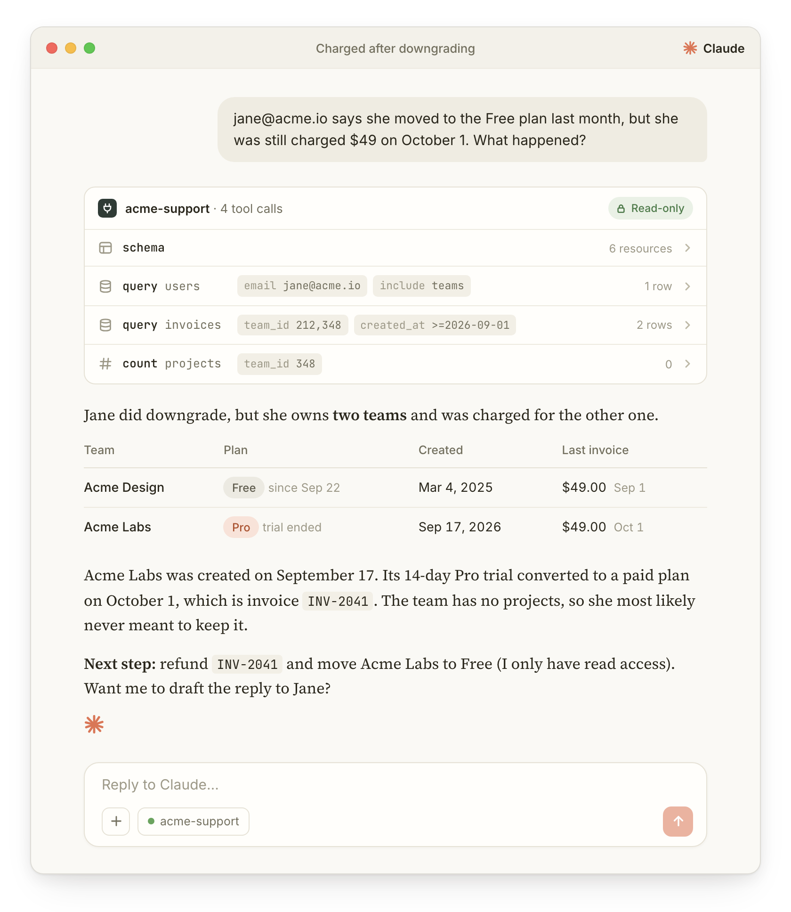

# Back-office MCP

Let an AI agent read your Laravel application's database through a strict, read-only whitelist of Eloquent models.

<p align="center"></p>

It is meant for internal tools: an admin server for you, a support server for your support team… Each server exposes three tools: `schema`, `query` and `count`. It is built on [`laravel/mcp`](https://github.com/laravel/mcp) and [`spatie/laravel-query-builder`](https://github.com/spatie/laravel-query-builder).

Anything absent from the whitelist is unreachable. A column that is not listed is never selected nor returned, and a filter, sort, relation or resource that is not listed is rejected rather than silently ignored.

## Installation

```sh
composer require mnapoli/backoffice-mcp
```

## Declaring a server

Create one class per audience, and declare what it can read:

```php
use BackofficeMcp\Filter;
use BackofficeMcp\McpServer;
use BackofficeMcp\Resource;

class AdminMcpServer extends McpServer
{
    protected string $name = 'Acme Admin';

    protected function resources(): array
    {
        return [
            Resource::for(Team::class)
                ->columns('id', 'name', 'plan', 'owner_id', 'created_at', 'deleted_at')
                ->filter('name', Filter::Partial)
                ->filter('plan', Filter::Exact)
                ->filter('created_at', Filter::Operator)
                ->sorts('id', 'created_at')
                ->include('owner', 'users')
                ->include('projects', 'projects'),

            Resource::for(User::class)
                ->columns('id', 'name', 'email', 'created_at')
                ->filter('email', Filter::Exact),

            Resource::for(Project::class)
                ->columns('id', 'team_id', 'name', 'created_at')
                ->filter('team_id', Filter::Exact),
        ];
    }
}
```

- `Resource::for()` takes the model, and optionally the name the agent will use for it (the table name by default).
- `columns()` lists what may be read. It is also the default `SELECT`.
- `filter()` makes a column filterable:
    - `Filter::Exact` matches the value,
    - `Filter::Partial` matches it anywhere in the column,
    - `Filter::Operator` accepts a leading `>`, `<`, `>=`, `<=` or `<>`, for example to filter on date ranges.
- `sorts()` lists the columns that may be sorted on.
- `include()` allows a relation to be loaded or counted. Related rows are read through the whitelist of the resource named as the second argument, never through the model directly.

Soft-deleted rows are excluded unless the agent asks for them with `trashed`.

The model's own `$hidden`, `$visible` and `$appends` are ignored: the whitelist alone decides what a row contains.

Tell the agent what the server is for with `$description`, for example which application this is and which repository holds its code:

```php
protected string $description = 'The Acme database, for its support team. The application is the acme/app repository.';
```

It comes before the generic instructions on using the tools, which also tell the agent to explore the application's code to understand the data. Override `$instructions` to replace those entirely.

## Exposing it

Publish the configuration file:

```sh
php artisan vendor:publish --tag=backoffice-mcp-config
```

Then declare your servers in `config/backoffice-mcp.php`. Each one is behind a bearer token, or behind a login with the user accounts of your application.

### Behind a token

```php
return [
    'servers' => [
        'admin' => [
            'server' => App\Mcp\AdminMcpServer::class,
            'path' => 'mcp/admin',
            'auth' => [
                'token' => env('ADMIN_MCP_TOKEN'),
            ],
        ],
    ],
];
```

Each server has its own bearer token. **When the token is empty, the route is not registered at all**: the URL answers 404, so a server stays off in every environment until you set its token there.

Generate a token with `openssl rand -hex 32`, then connect a client:

```sh
claude mcp add acme-admin --transport http https://example.com/mcp/admin \
    --header "Authorization: Bearer $TOKEN"
```

### Behind a login (OAuth)

Claude (web, desktop and mobile), ChatGPT and most MCP clients connect with OAuth: you add the URL of the server, log in to your application in the browser, and approve the client. Only the users who pass the gate of the server can connect.

```php
'support' => [
    'server' => App\Mcp\SupportMcpServer::class,
    'path' => 'mcp/support',
    'auth' => [
        'oauth' => true,
        'gate' => 'useSupportMcp',
    ],
],
```

Define the gate in a service provider, it receives the logged-in user:

```php
Gate::define('useSupportMcp', fn (User $user) => $user->is_support_agent);
```

The gate is checked on every request, so a user who loses the right loses access immediately, whatever tokens their clients hold. The gate is required: without one, every user of your application could read the server.

OAuth runs on [Laravel Passport](https://laravel.com/docs/passport):

1. Install it:

    ```sh
    composer require laravel/passport
    php artisan passport:install
    ```

    Your user model needs neither Passport's `HasApiTokens` trait nor an `api` guard, so Passport can live alongside Sanctum. Users are those of the guard that Passport logs them in with, `web` unless you set `passport.guard`. In production, give Passport its keys with the `PASSPORT_PRIVATE_KEY` and `PASSPORT_PUBLIC_KEY` environment variables.

2. Publish the consent screen, adapt it to your application's layout and styles, and tell Passport to use it in a service provider:

    ```sh
    php artisan vendor:publish --tag=mcp-views
    ```

    ```php
    Passport::authorizationView(fn ($parameters) => view('mcp.authorize', $parameters));
    ```

    Passport's access tokens last a year by default. MCP clients refresh theirs, so a shorter lifetime costs nothing and limits what a leaked token is worth: `Passport::tokensExpireIn(now()->addHour())`.

3. Any MCP client can register itself and ask your users for access, under any name. By default it can then send them back anywhere after the consent screen, with the code that gets it a token. Limit that to the clients you use, in `config/mcp.php` (`php artisan vendor:publish --tag=mcp-config`):

    ```php
    'redirect_domains' => [
        'https://claude.ai',
        'https://chatgpt.com',
        'http://localhost', // Claude Code
    ],
    ```

Users who are not logged in are sent to your `login` route, then back to the consent screen. To connect:

- Claude: *Settings > Connectors > Add custom connector*, with the URL of the server.
- Claude Code: `claude mcp add acme-support --transport http https://example.com/mcp/support`, then `/mcp` to log in.

Turn OAuth off for an environment with `'oauth' => (bool) env('SUPPORT_MCP_OAUTH')`: the route is then not registered, as with an empty token.

### Throttling and logging

Requests are throttled to 60 per minute per server, and per IP address or, behind OAuth, per user (`requests_per_minute` to change it). Every tool call is logged with `Log::info()`, with the `user_id` behind OAuth.

## Limits

Each server can override its limits:

```php
class SupportMcpServer extends McpServer
{
    public int $maxLimit = 50;
    public int $queryTimeout = 3;
    // ...
}
```

| Property | Default | |
|-|-|-|
| `defaultLimit` | 25 | Rows returned when the agent does not say. |
| `maxLimit` | 200 | Rows returned at most. Pagination is offset-based, and every sort ends on the primary key so that pages are stable. |
| `maxIncludedRows` | 25 | Related rows loaded per row for an included relation (the most recent ones). Use `counts` to count them all. |
| `maxTotalIncludedRows` | 10 000 | Related rows one request may load in total (rows × relations × related rows). A request over it is refused, saying which limit to lower. |
| `maxResponseBytes` | 100 000 | JSON size of one page of rows. A page over it is trimmed to what fits and comes back with `next_offset` and a `suggested_limit`. The default keeps a response to what an agent can afford to read. |
| `queryTimeout` | 8 | Seconds all the queries of one request may run, divided between them. `0` turns it off. MySQL, MariaDB and PostgreSQL only. |

On AWS Lambda behind API Gateway, keep `maxResponseBytes` under about 1 MB: the response is encoded several times on its way out (structured content, text content, then the Lambda payload), and API Gateway caps it at 6 MB.

## What is deliberately missing

There is no `GROUP BY` and no raw SQL. The agent aggregates with the `count` tool, or with the `counts` argument of `query` for a per-row relation count.

Writes are not supported.

## Testing your whitelist

Tools can be called in tests on your own server:

```php
use BackofficeMcp\Tools\QueryTool;

AdminMcpServer::tool(QueryTool::class, ['resource' => 'teams', 'filter' => ['plan' => 'pro']])
    ->assertOk()
    ->assertStructuredContent(fn ($json) => $json->where('returned', 1)->etc());
```

`AdminMcpServer::tool(SchemaTool::class)` returns the whole whitelist, with the database type of each column. Use it to check that every whitelisted column exists in your schema.

## Contributing

```sh
composer install
vendor/bin/phpunit
vendor/bin/phpstan analyse
```

The tests run on SQLite. To run them against a real server, which is the only way to test the query timeout, set `DB_CONNECTION` (`mysql`, `mariadb` or `pgsql`) and `DB_PORT`, `DB_USERNAME`, `DB_PASSWORD`, `DB_DATABASE`.
